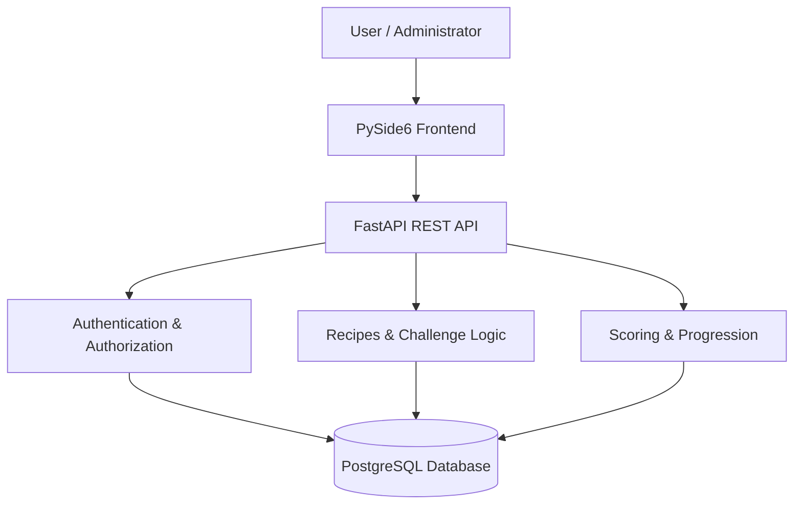

## System Design & Architecture

### Overview

Kitchen Quest follows a **three-tier architecture**, separating the user interface, backend application logic, and database. This allows the team to develop, test, and maintain each component independently.

The application is designed as a gamified 2D cooking simulator where users complete interactive cooking challenges, receive feedback, and progress through increasingly difficult recipes.

### Technology Stack

| Layer | Technology | Purpose |
|---|---|---|
| Frontend | Python, PySide6 | Desktop interface, 2D kitchen simulation, user interactions |
| Backend | Python, FastAPI | REST API, authentication, challenge validation, progression logic |
| Database | PostgreSQL, SQL | Persistent storage for users, recipes, challenges, and progress |
| Version Control | Git, GitHub | Collaboration and source code management |
| Project Management | Jira | Sprint planning and task tracking |

### Architecture Diagram

### Component Responsibilities

**1. Frontend — PySide6**

The frontend handles everything the user sees and interacts with, including:

- Account registration and login screens
- Recipe and lesson selection
- Interactive 2D virtual kitchen
- Click-and-drag ingredient and equipment interactions
- Visual feedback, challenge results, and user progress
- Administrator management interfaces

The frontend communicates with the FastAPI backend through HTTP requests and receives JSON responses.

**2. Backend — FastAPI**

The backend is responsible for the application's business logic and communication with the database.

Main responsibilities include:

- User authentication and role-based authorization
- Retrieving available recipes and challenges
- Validating cooking challenge results
- Calculating accuracy scores, XP, and level progression
- Determining which recipes and skills users can unlock
- Saving and retrieving user progress
- Processing administrator content-management requests

Keeping this logic separate from the UI makes it easier to maintain consistent rules across the application.

**3. Database — PostgreSQL**

PostgreSQL provides centralized, persistent storage for the application.

The planned data model includes:

- **Users:** Account information and member/administrator roles
- **Recipes and Lessons:** Ingredients, equipment, instructions, and learning objectives
- **Challenges:** Required cooking actions, completion conditions, and difficulty
- **Attempts:** Challenge results, accuracy scores, and completion history
- **User Progress:** Total XP, current level, completed lessons, and unlocked content

Related records are connected through primary and foreign keys to maintain data integrity.

### Application Data Flow

1. A user signs into Kitchen Quest through the PySide6 application.
2. The frontend sends an authentication request to FastAPI.
3. The backend validates the request and retrieves the appropriate account information.
4. The user selects a recipe or cooking challenge.
5. The frontend retrieves the challenge information and displays the interactive kitchen.
6. The user completes cooking actions using the available ingredients and equipment.
7. The application evaluates actions, provides instructional feedback, and submits challenge results for backend validation.
8. The backend calculates the final score and eligible XP, then saves the attempt and updated progress in PostgreSQL.
9. The frontend displays the results, updated level, and any newly unlocked content.

### Design Considerations

**Modularity:** The frontend, API, and database are separated so changes to one component do not require rewriting the entire application.

**Data Integrity:** Backend validation and database constraints help prevent inconsistent progress, duplicate rewards, and invalid challenge records.

**Security:** User passwords will be securely hashed, API inputs validated, and administrator-only operations restricted using role-based authorization.

**Maintainability:** Recipes and challenge definitions are stored separately from the interface, allowing the team to introduce new learning content without rebuilding the application.

**Extensibility:** The architecture supports future additions such as daily challenges, cooking streaks, achievements, and leaderboards.

### Development Scope

The initial release focuses on the core cooking-learning experience: authentication, interactive recipes, challenge feedback, XP progression, saved user progress, and administrator content management.

Additional engagement features will be developed after the core application and its frontend/backend/database integrations are stable.