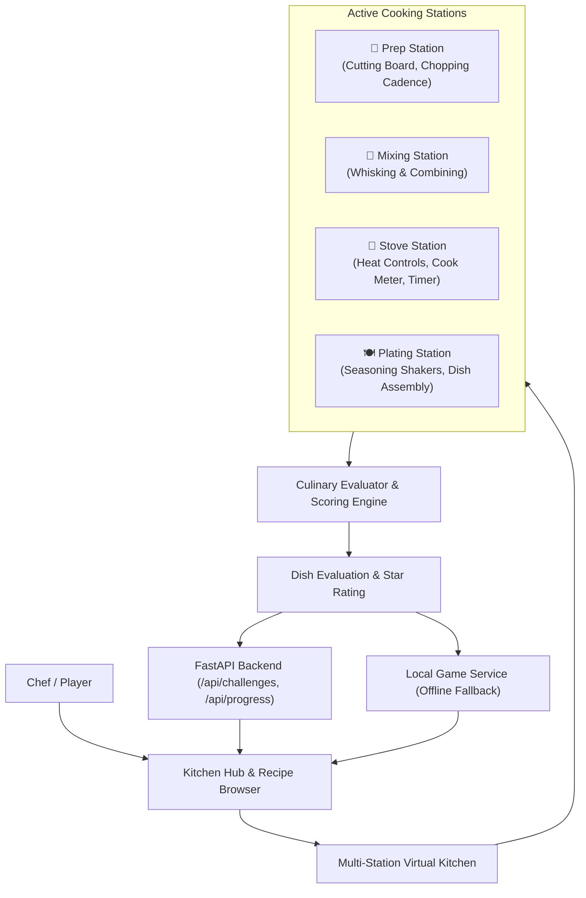

# Kitchen Quest Gameplay Architecture & Developer Guide

## Overview

Kitchen Quest implements a multi-station 2D interactive cooking simulator and challenge progression system. The gameplay logic is built across both frontend simulation and backend API validation layers with built-in offline fallback support.



---

## 1. Multi-Station Cooking Mechanics

The virtual kitchen provides four dedicated workstations mimicking real culinary workflows:

### 🔪 Prep Station (Cutting Board)
- **Equipment:** Wooden Cutting Board & Chef's Knife.
- **Actions:** `Chop`, `Slice`, `Dice`, `Mince`.
- **Mechanics:** Click cadence (3 clicks per prep operation) with cutting progress bar and state transformation (e.g. `Raw Tomato` ➔ `Chopped Tomato`).

### 🥣 Mixing Station (Mixing Bowl)
- **Equipment:** Stainless Steel Mixing Bowl, Whisk, and Spoon.
- **Actions:** `Whisk`, `Stir`, `Combine`.
- **Mechanics:** Emulsification / combining progress bar (4 whisk clicks) to blend ingredients (e.g. eggs & salt, or vinaigrette).

### 🍳 Stove Station (Burner & Skillet)
- **Equipment:** Non-stick Pan / Pot on an adjustable heat burner.
- **Heat Controls:** `OFF`, `LOW`, `MEDIUM`, `HIGH`.
- **Mechanics:** Real-time temperature & cook time tracking with state progression:
  - `Raw` ➔ `Cooking` ➔ `Perfect` (Gold zone) ➔ `Overcooked` ➔ `Burnt` (Excessive heat/time penalty).
- **Actions:** `Sauté`, `Simmer`, `Boil`.

### 🍽️ Plating Station (Serving Counter)
- **Equipment:** Serving dish / bowl.
- **Actions:** Component plating, seasoning (`Salt`, `Pepper`, `Fresh Basil`, `Chives`).
- **Finish:** `Finish & Serve Dish` triggers comprehensive culinary evaluation.

---

## 2. Scoring & Progression Engine (`gameplay/engine.py`)

### Accuracy Evaluation Rubric (0% to 100%)
1. **Technique & Prep (15%):** Correct cutting techniques applied to the required recipe ingredients.
2. **Heat & Cooking (35%):** Correct burner heat setting, cook duration within recipe tolerance, and prevention of burnt/overcooked food.
3. **Seasoning & Plating (15%):** Correct seasonings and garnishes added.
4. **Sequence & Time (35%):** Following logical recipe step sequence and completing within the challenge time limit (+ speed bonus, - overtime penalty).

### Star Thresholds & XP Rewards
- **⭐⭐⭐ (3 Stars):** $\ge 90\%$ accuracy. Base XP + 30 XP star bonus.
- **⭐⭐ (2 Stars):** $75\% - 89\%$ accuracy. Base XP + 15 XP star bonus.
- **⭐ (1 Star):** $50\% - 74\%$ accuracy. Base XP scaled to accuracy.
- **0 Stars:** $< 50\%$ accuracy (Dish needs improvement, 10 pity XP).

### Chef Ranks & Level Progression
| Level | Title | XP Required |
|---|---|---|
| **1** | Prep Cook | 0 XP |
| **2** | Commis Chef | 100 XP |
| **3** | Chef de Partie | 250 XP |
| **4** | Sous Chef | 500 XP |
| **5** | Executive Chef | 850 XP |
| **6** | Master Chef | 1,300+ XP |

---

## 3. Backend Endpoints (`backend/app/main.py`)

| Endpoint | Method | Role | Description |
|---|---|---|---|
| `/api/challenges` | `GET` | User | Lists all cooking challenges with user's personal best stars and scores |
| `/api/challenges/{id}` | `GET` | User | Retrieves full challenge definition, required steps, and ingredient specs |
| `/api/challenges/{id}/attempts` | `POST` | User | Submits cooking actions log, evaluates accuracy, updates XP/level, and saves attempt record |
| `/api/progress` | `GET` | User | Retrieves current chef level, XP progress, completed challenges, and total stars |

---

## 4. Running Tests

### Core Gameplay Engine Tests (Pure Python)
```powershell
python -m unittest discover -s tests -v
```

### Full Backend API & Gameplay Integration Tests
```powershell
$env:PYTHONPATH = "."
python -m unittest tests/test_backend_gameplay.py -v
```

### Frontend Offscreen UI Tests
```powershell
python -m unittest frontend/tests/test_kitchen_ui.py -v
```

